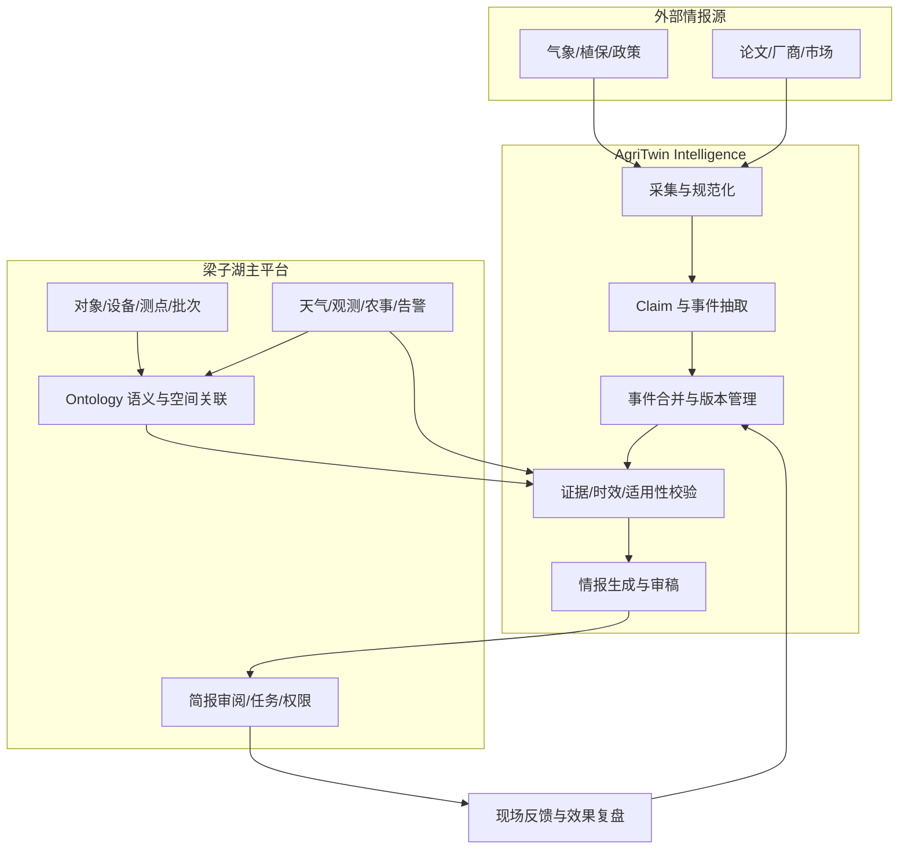

# AgriTwin Intelligence — 农业情报智能系统需求与实施规划

> **文档类型**：产品需求文档（PRD）+ 技术架构与实施路线图  
> **版本**：V1.0  
> **日期**：2026-10-10  
> **适用项目**：梁子湖智慧农业平台 / AgriTwin Intelligence  
> **状态**：规划建议稿，待产品负责人、农技负责人及工程负责人联合评审  
> **范围说明**：本文根据两个项目仓库的当前公开工程说明、已检查的部分核心源码，以及既有产品讨论整理。文中“建议新增”的模块、表和 API 均非既有实现；不代表实际设备、信源或专业模型已完成现场验证。

**关联仓库**：

- 信源简报后端：<https://github.com/No1dry/AgriTwin-Intelligence>
- 梁子湖主平台：<https://github.com/8jdkds7nzz-hub/liangzihu-farm-platform>
- AgriTwin 现有农业接入设计：<https://github.com/No1dry/AgriTwin-Intelligence/blob/main/docs/agriculture-digital-twin-integration-v1.md>

---

## 0. 执行摘要

### 0.1 核心结论

AgriTwin Intelligence 不应只定位为“农业新闻自动摘要系统”，而应发展为 **Agricultural Intelligence System（农业情报智能系统）**：持续获取农业内外部信息，识别真实事件与有效变化，结合农业 Ontology 和农场业务事实判断适用性，形成**有来源、可解释、可跟进**的情报与建议。

核心价值链：

> **信息获取（Information）→ 情报理解（Intelligence）→ 农场情境关联（Context）→ 决策支持（Decision Support）→ 反馈与复盘（Feedback）**

核心差异不是“抓更多信源、生成更长简报、增加更多 Agent”，而是**把外部变化与具体农场对象及业务行动连接起来**。

### 0.2 首版策略

1. 先实现稳定、可信的农业情报管线，形成独立可用的日报/周报。
2. 以主平台现有对象 ID 为中心，建设轻量级 Ontology 映射及事件关联。
3. 以**强降雨/农业气象预警 → 农田与塘口关联 → 情报快报 → 人工审阅 → 巡检任务 → 现场反馈**为第一个跨系统闭环。
4. 复用主平台现有 `/briefings`、`/knowledge`、`/assistant` 及任务、权限、审计机制，避免重复造轮子。
5. 不将 LLM 生成内容视作专业事实认证；不使用情报模块直接驱动水泵、闸门、施肥或喷药等实际设备。

### 0.3 四期路线

| 阶段 | 重点 | 可验证产物 |
|---|---|---|
| P0：农业情报 MVP | 信源、证据、事件抽取、去重、专题简报 | 可独立运行的农业日报/周报与事件清单 |
| P1：Ontology 关联 | 统一对象 ID、农业语义匹配、时空适用性 | 情报准确定位到农场对象并解释匹配原因 |
| P2：主平台业务闭环 | 审阅、任务草稿、订阅、反馈 | 情报→人工确认→任务→效果记录 |
| P3：情境智能与持续优化 | 事件记忆、专业规则、专题画像、效果评估 | 个性化决策支持与可量化质量指标 |

---

## 1. 项目背景与现有系统盘点

### 1.1 产品背景

农业经营既受农场内部条件（农田、塘口、设备、作物、测点、任务）影响，也受外部变化（天气、病虫害、政策、市场、技术）影响。传统农场平台偏向**内部状态与业务记录**；传统资讯简报偏向**外部信息摘要**。缺口在于：系统能否判断外部变化会对本场哪些对象产生影响，并把判断依据交给有权限的人处理。

### 1.2 已有基础（根据仓库代码/文档）

| 所属仓库 | 已有能力/事实 | 尚需补足/注意事项 |
|---|---|---|
| AgriTwin Intelligence | 继承 FeishuBrief 的 RSS/API/网页来源适配、去重、新鲜度处理、LLM 摘要、主编/审稿、HTML/JSON 输出、通知适配器、部分检查脚本 | 农业专用来源、FarmBrief 协议、实体关联、农场数据适配、农业专业规则等仍属待开发；原财经/科技/时政栏目的约束不能沿用 |
| 梁子湖主平台 | Next.js/React/TypeScript；PostgreSQL、PostGIS、pgvector；农场对象、设备、测点、批次、天气、告警、知识、简报、任务及权限机制 | 已有业务关系与文档 RAG 并不等于完整的 OWL/RDF Ontology；部分真实设备联调、农业模型及生产验收尚未完成 |
| 主平台简报模块 | 日/周/月程序草稿、事项审阅、发布、任务草稿及对应证据引用 | AgriTwin 不应平行重建相同工作流，应补充外部情报及其证据类型 |
| 主平台知识模块 | 审核资料、切片、关键词/向量搜索、出处查询 | 擅长文档检索，但不负责完整农业对象语义模型和事件版本推理 |

**关键现有代码**：

- `db/migrations/002_registry.sql`：`objects`、`production_batches`、`devices`、`points`、`point_bindings` 等核心表。
- `src/modules/registry/objects.ts`、`devices.ts`、`points.ts`：对象、设备、测点管理及授权、版本/绑定逻辑。
- `src/modules/knowledge/service.ts`：资料审核与 RAG 检索。
- `src/modules/briefings/service.ts`：内部简报事实汇总、审阅与任务流转。
- `src/modules/analysis/evidence.ts`：事实引用有效性检查。
- `AgriTwin/lib/sources/types.ts`、`lib/ai/pipeline.ts`：目前仍偏通用科技/财经/时政信息结构与简报流程。

**命名提醒**：主平台 `data_sources` 主要描述设备/业务数据来源，和农业外部新闻、政策、文献的 `InformationSource` 并非同一概念；应分开建模并在需要时建立关联。

---

## 2. 产品定位、用户与边界

### 2.1 产品愿景

构建面向农业经营的**持续感知、证据驱动、具备事件记忆和农场情境理解能力的智能情报系统**。

系统应能回答：

- **发生了什么？** 哪个来源报告了什么事件/变化？
- **与我有关吗？** 影响的区域、作物、设备、地块及生产阶段是否匹配？
- **为什么值得关注？** 证据、影响路径、缺口、有效期是什么？
- **下一步做什么？** 应当关注、核查、安排人工任务还是仅归档？
- **后来怎么样？** 事件更新/解除了吗，现场结果如何，之前判断是否合理？

### 2.2 目标用户

| 角色 | 核心问题 | 主要交付 |
|---|---|---|
| 农场负责人 | 今日风险、待办、经营变化是什么？ | 经营晨报、风险摘要、任务跟进 |
| 农技/植保人员 | 什么病虫害、天气和技术信息与当前作物有关？ | 作物专题情报、证据和关联地块 |
| 值班与现场人员 | 哪些事件需要核查，现场需要记录什么？ | 待核事项、巡检任务草稿、反馈入口 |
| 农机/设备负责人 | 特定设备有什么故障预警或技术更新？ | 型号级情报、维护资料、关联资产 |
| 研发人员 | 哪些论文、算法、机器人和遥感技术适合试验？ | 技术周报、研究适用条件与试验建议 |
| 经营/财务人员 | 哪些政策、价格和成本变化值得关注？ | 政策/市场专题及适用性初筛 |

### 2.3 产品边界

**纳入**：多信源获取、结构化事实/事件抽取、同事件合并、可信度和适用性分析、Ontology 对象关联、简报/快报、审核/发布、反馈闭环。

**暂不纳入首版**：

- LLM 自动决定灌溉量、施肥量、农药剂量或产量收益预测。
- 通过情报模块直接下发水泵、闸门、农机和喷洒等实体控制指令。
- 未校准专业模型支持下的灾害损失率、精细作物生长模拟和情景推演。
- 替换主平台的对象主数据、权限体系、告警引擎或传感器高频存储。
- 以“大而全农业百科/本体”为第一阶段目标。

**原则**：资讯不等于事实；模型解释不等于专业审批；预警不等于现场已发生事件；任务草稿不等于指令已执行。

---

## 3. 需求分类与优先级

> 优先级：**P0**＝首版必须；**P1**＝完成跨系统可用闭环；**P2**＝增强与扩展。此处为功能优先级，与第 0 节实施阶段名称相互对应但不完全相同。

### 3.1 五类产品输出

| 编号 | 业务场景 | 用户 | 频率/触发 | 功能优先级 |
|---|---|---|---|---|
| BR-01 | 农场经营晨报：状态、异常、当日关注、任务摘要 | 负责人、值班人员 | 每日定时 | P1：优先复用主平台现有简报 |
| BR-02 | 农业风险事件快报：天气/病虫害/外部风险 | 农技、现场、负责人 | 事件发生或重大更新触发 | P0 |
| BR-03 | 农业技术情报周报：论文、机器人、遥感、作物模型、工程技术 | 研发、农技人员 | 每周 | P0 |
| BR-04 | 政策与经营情报：补贴、保险、农产品价格、投入品变化 | 经营人员 | 周期性+事件触发 | P1 |
| BR-05 | 自定义专题追踪：作物、设备、区域、研究主题 | 专业用户 | 用户配置 | P2 |

### 3.2 通用功能清单

| ID | 功能 | 要求 | 优先级 | 验收依据 |
|---|---|---|---|---|
| F01 | 农业信源注册 | 支持来源类型、发布机构、地区、主题、许可、频率、风险等级等元数据 | P0 | 能独立注册/停用来源、保留获取与失败记录 |
| F02 | 来源采集与规范化 | RSS/API/网页获取；失败隔离；保存来源 URL、发布时间和原始证据引用 | P0 | 单一来源故障不使全局抓取失败 |
| F03 | 农业专题分类 | weather、pest、crop、equipment、policy、market、research 等类别 | P0 | 不再依赖 `tech/finance/politics` 作为农业报告主分类 |
| F04 | 文章/声明抽取 | 从文档产生可回溯 `Claim`，保留原句位置及适用条件 | P0 | 每个关键声明有原始来源与抽取版本 |
| F05 | 事件发现、聚合与版本 | 区分新事件、转载、实质更新、更正、解除 | P0 | 同事件多来源合并；重大更新不被误去重 |
| F06 | 证据与质量门禁 | 校验来源、生效期、结构、对象归属；失败时“待核实”而非强行输出 | P0 | 缺失关键证据不能生成确定性农业操作建议 |
| F07 | 农业日报/周报 | 输出结构化 JSON + 可读报告；允许零资讯/零风险 | P0 | 无事件时输出合法、明确的“无新增重要事件”报告 |
| F08 | Ontology 对象关联 | 按地区、作物、生育期、设备能力等关联农场对象 | P1 | 每个关联结果有命中依据及未满足条件 |
| F09 | 影响评估 | 区分适用、可能影响、证据不足、不适用 | P1 | 关联不到对象时不得臆造地块或设备 |
| F10 | 主平台集成 | 通过受控 API/事件适配复用现有简报审核、发布和任务流程 | P1 | 外部情报可作为主平台有来源的简报事项 |
| F11 | 事件反馈闭环 | 记录采纳、驳回、已核实、误报、结果、后续状态 | P1 | 可由事件回查关联任务和现场证据 |
| F12 | 用户专题与订阅 | 按角色、对象、地区、作物、主题选择频率与渠道 | P2 | 订阅不绕过对象授权；可停用 |
| F13 | 事件记忆与复盘 | 保留事件生命周期及判断版本，形成历史复盘 | P2 | 可查看每次重大更新、解除和反馈 |
| F14 | 专业模型/仿真适配 | 经验证的模型提供数值依据，LLM 只解释结果 | P2 | 模型版本、输入、适用范围及误差可查 |
| F15 | 系统质量运营 | 来源健康、延迟、误报/漏报、成本、失效及反馈面板 | P1 | 可以导出按时段统计的质量报告 |

### 3.3 非功能要求

- **正确性**：不将预报写成实测，不将“相关”写成“已发生”，不把数据缺失解释为正常。
- **可追溯**：重要输出应关联 `sourceId/documentId/claimId/eventVersion`，模型运行记录应保存模型/提示词/输入快照版本。
- **时效性**：发布前重新验证预警有效期、来源状态及对象上下文版本；过期应阻断或降级为历史信息。
- **可用性**：采集、LLM、Ontology、主平台任一环节故障时局部降级；不能阻断主平台已有实时告警和安全控制链路。
- **安全性**：跨系统访问按最小权限授权、审计、速率限制及幂等；外部文章不得成为模型工具指令。
- **隐私与合规**：对外部模型只传必要的农场摘要；精确位置、设备详情、图像原件等按业务授权处理。
- **成本控制**：先规则过滤，再进行高成本 LLM 分析；按事件重要性决定审查强度。

---

## 4. 信源策略与编辑体系

### 4.1 首版信源分类

| 类别 | 候选来源方向 | 关键核对项 |
|---|---|---|
| 农业气象/灾害 | 国家与地方气象机构、官方预警平台 | 发布区域、预警等级、时段、更新与解除 |
| 病虫害与农情 | 农业农村主管部门、植保机构、农技推广机构 | 作物、病虫害、发生区域、建议适用条件 |
| 农业技术研究 | 农业科研机构、高校、专业期刊、论文及代码库 | 发表状态、方法、样本环境、复现资料 |
| 农机与智能装备 | 设备厂商、技术公告、行业标准 | 型号、固件版本、维护适用范围 |
| 政策与经营 | 政府政策公告、产业数据、官方市场信息 | 管辖区域、主体资格、有效期、原始条款 |

上述是**候选来源方向**，不表示已有可用 API、授权或运行中的订阅。首版优先选取约 10–20 个可核验的高价值来源，数量不是 KPI。

### 4.2 信源质量模型

建议分别记录：

1. **来源属性**：官方/研究/厂商/媒体/社区、原始发布者或转载者、历史可用性。
2. **事实属性**：是否有原始资料、完整时间、地理范围、结论的适用条件。
3. **事件属性**：新发生、更新、解除、修订、争议、过期。
4. **业务属性**：是否关联本场、是否影响作物/资产/任务、是否需人工跟进。

**禁止**将“来源权威性”“业务重要性”“事实确定性”合成为一个未经校验的 LLM 总分。可以分别展示多个维度，并由确定性规则控制关键事项发布。

### 4.3 分级发布

- **事件快报**：需要及时关注的重大有效预警，触发时生成；须在正式发布前满足时效/证据门禁，涉及现场处置时保留人工确认。
- **农场晨报**：内外部事实合并；优先由主平台业务简报承载。
- **农业技术周报**：以研究价值、方法局限、应用条件为核心。
- **专题归档**：不重要或暂不适用，但有长期检索价值的信息。

农业报告**不得强制要求固定条数**；无重大事件是有效输出。

---

## 5. Ontology 与情报系统的分工

### 5.1 统一对象主数据原则

- **梁子湖主平台**：拥有农场事实的权威主记录，例如 `objects.id`、`devices.id`、`points.id`、`production_batches.id` 以及权限、审核和任务状态。
- **Ontology 语义层**：为业务对象建立农业概念类型、能力及关系，提供统一术语和语义查询；优先复用主平台 ID，不新造另一套农田/设备身份。
- **AgriTwin**：负责外部信息的 `SourceDocument → Claim → AgricultureEvent → ImpactAssessment → Brief` 流程，引用上述对象 ID，不直接改写农场事实。

### 5.2 核心语义模型（首版）

| 本体/实体 | 示例 | 映射到现有业务数据 |
|---|---|---|
| Farm、Field、Pond、Channel、Facility | 农场、农田、塘口、沟渠、设施 | `objects` |
| Device、Sensor、Actuator | 监测设备、水泵、阀门 | `devices`；更细设备能力需补充 |
| MeasurementPoint、ObservedProperty | 土壤水分测点、塘口水位指标 | `points`、`point_bindings` |
| CultivationCycle | 某地块当前种植批次 | `production_batches` |
| SpatialFeature | 已核实边界和设备位置 | PostGIS 地理数据 |
| AgricultureEvent、Claim、ImpactAssessment | 强降雨预警、虫害预警、影响判断 | **建议新增的情报域模型** |

本体标准可按需借鉴 **SAREF4AGRI**（智慧农业）、**SOSA/SSN**（感知与观测）、**GeoSPARQL**（空间语义）、**AGROVOC**（农业术语）、**PROV-O**（来源溯源），不要求首版引入完整外部词库或图数据库集群。

### 5.3 匹配逻辑

```text
外部情报事件
  → 时效/来源核验
  → 地理范围匹配
  → 作物/品种/生育期匹配
  → 设备与水利网络等真实能力匹配
  → 缺失条件与不确定性标注
  → 可能影响的农场对象
  → 审阅和简报
```

**关键约束**：

- 地理位置相邻不等于沟渠/管道连通；没有核实的连通性，不得推断水泵可以灌溉某块田。
- 病虫害信息涉及“水稻”不等于本场一定发生虫害；应结合地区、当前种植周期和现场证据。
- 预警只命中行政区域而地块边界未知时，应标记“地理匹配待核实”。
- 传感器数值应使用其测点绑定的有效时间和数据质量状态，避免历史对象错配。

### 5.4 查询方式

第一阶段可在现有 PostgreSQL/PostGIS 上建立映射和关系服务；本体类定义可以维护为可版本化的 TTL/OWL 文件。只有出现跨领域推理、复杂 SPARQL 或图数据交换等明确需求时，再评估 Apache Jena Fuseki、GraphDB 等 RDF 存储。

---

## 6. 目标架构与数据流



### 6.1 系统职责界线

| 组件 | 负责 | 不负责 |
|---|---|---|
| 外部采集与事件管线（AgriTwin） | 抓取、抽取、聚合、标注和情报生成 | 直接写入设备实时测值或执行设备命令 |
| Ontology/上下文服务（主平台建议新增） | 业务实体映射、语义关系、空间/作物匹配 | 自行采集所有外部新闻 |
| 主平台知识模块 | 审核过的文档、文本检索和引用 | 独立维护农田/水泵的另一套主数据 |
| 主平台简报模块 | 审阅、权限、发布、任务草稿 | 重新开发 AgriTwin 的外部信息采集引擎 |
| 主平台告警和控制体系 | 测值阈值告警及经验证的安全控制链路 | 由 LLM 自动替代设备安全保护 |

### 6.2 原则性接口（拟新增/改造，并非已有接口）

| 方向 | 建议接口/事件 | 作用 |
|---|---|---|
| AgriTwin → 主平台 | `GET /api/v1/ontology/context?objectId=...` | 获取当前用户/服务主体有权读取的农场上下文 |
| AgriTwin → 主平台 | `POST /api/v1/ontology/match-event` | 返回命中实体、规则证据及待核条件 |
| 主平台 → AgriTwin | `GET /api/agriculture/events?farmId=...` | 查询外部事件及其版本 |
| 主平台 → AgriTwin | `GET /api/agriculture/briefs?farmId=...` | 查询农业情报报告 |
| AgriTwin → 主平台 | **内部服务接口：情报证据导入**（路径待定） | 将事件/证据映射为可审阅的简报事项 |
| 主平台 → AgriTwin | `POST /api/agriculture/feedback` | 提交核实、驳回与效果反馈 |

实现前应检查主平台现有 `/api/v1/objects`、`/api/v1/points`、`/api/v1/knowledge/search`、`/api/v1/briefings` 等接口的实际权限和返回协议。现有 API 以用户会话/Actor 为主，**不能假设独立后端可直接匿名或凭普通令牌调用**；跨服务需要专用服务身份、限定对象范围和审计机制。

### 6.3 存储分工

- 主平台 PostgreSQL/PostGIS：农田、塘口、设备、测点、测值与业务事实；保留时序和空间数据的权威来源。
- AgriTwin 存储：原始外部文档引用、结构化声明、事件版本、关联与审稿运行记录。
- 主平台简报/任务：最终经审核的业务简报条目、发布范围、任务草稿、人工反馈。
- 不复制全部高频观测；引用当前可读取、具有版本和质量信息的必要快照。

---

## 7. 建议领域数据模型

### 7.1 关键对象

| 实体 | 主要字段 | 用途 |
|---|---|---|
| `InformationSource` | `id,name,type,authority,region,license,updatePolicy,status` | 区分外部信息源与设备源 |
| `SourceDocument` | `id,sourceId,url,title,publishedAt,collectedAt,hash,version` | 保存可追溯原始载体 |
| `Claim` | `id,documentId,claimText,claimType,scope,verificationStatus` | 保存“某来源声称了什么” |
| `AgricultureEvent` | `id,eventType,canonicalKey,status,firstSeenAt,lastUpdatedAt` | 同一现实事件的稳定身份 |
| `EventVersion` | `id,eventId,version,changeType,validFrom,validTo,evidenceIds` | 记录发布、修订、解除、撤销 |
| `EntityMatch` | `eventVersionId,objectId,relation,ruleVersion,basis,limitations` | 外部事件与农场对象的关联证据 |
| `ImpactAssessment` | `id,eventVersionId,objectId,status,reason,missingData,assessedAt` | 分析可能影响并说明不确定性 |
| `FarmBrief` / `BriefItem` | `id,version,window,itemIds,inputSnapshot,reviewStatus` | 结构化情报报告 |
| `Feedback` | `id,eventId,objectId,taskId,disposition,evidence,recordedAt` | 审阅与现场结果 |

### 7.2 推荐最小 JSON 协议（示例数据，不代表已有实现）

```json
{
  "schemaVersion": "1.0",
  "eventId": "evt-demo-001",
  "eventVersion": 2,
  "eventType": "HeavyRainWarning",
  "status": "active",
  "sourceDocuments": ["doc-demo-101"],
  "publishedAt": "2026-10-10T07:00:00+08:00",
  "validFrom": "2026-10-10T08:00:00+08:00",
  "validTo": "2026-10-11T08:00:00+08:00",
  "affectedRegion": {"regionCode": "DEMO-REGION"},
  "matchedObjects": [
    {
      "objectId": "<existing-platform-object-uuid>",
      "relation": "potentiallyAffected",
      "matchStatus": "needs_verification",
      "evidenceIds": ["doc-demo-101"],
      "limitations": ["地块边界尚未完成核验"]
    }
  ],
  "recommendation": {
    "type": "inspection_draft",
    "requiresHumanApproval": true,
    "text": "核实降雨影响及现场排水情况"
  }
}
```

说明：发布状态、证据有效性、时间范围与对象匹配由程序校验；LLM 不得自行编造对象 ID 或设备能力。

### 7.3 事件状态与版本

推荐状态：`new → active → updated → resolved`，并独立允许 `disputed / withdrawn / superseded` 等需要追溯的状态。状态机具体细节需在工程设计中明确。

同一事件多来源转载应合并；新的严重程度、空间范围、解除公告必须生成事件版本而非静默覆盖。事件历史不可因最新信息到来而丢失。

---

## 8. 多模型编排、审核与安全

### 8.1 建议处理流水线

```text
抓取 → 低成本质量/重复过滤 → 结构化 Claim 抽取
     → 事件归并和版本更新 → Ontology/时空匹配
     → 规则及来源校验 → 分级生成解释/简报
     → 确定性校验 → 需要时独立模型审稿
     → 人工审阅/发布 → 反馈回写
```

### 8.2 模型职责

| 模块 | 合适任务 | 不得承担 |
|---|---|---|
| DeepSeek Worker / 轻量模型 | 摘要、声明抽取、候选分类、结构恢复 | 自行制造农业阈值和事实 |
| Kimi 主编 | 情报组织、针对用户角色的解释、稿件草拟 | 绕过平台权限生成执行命令 |
| DeepSeek Pro 审稿 | 检查来源引用、矛盾、表述与证据一致性 | 以模型间一致替代真实证据验证 |
| 规则/专业模型 | 适用性硬规则、数值计算及专业风险评估 | 在无校准数据下承诺农业效果 |
| 确定性编排器 | 权限、幂等、状态、时效、发布门禁、审计 | 擅自降低失败门槛凑出日报 |

依据重要性实施分级审查；普通科研简报不必与高风险现场建议使用相同的审稿成本。报告应保存每次模型的配置、版本与审稿轨迹。

### 8.3 安全底线

1. 重要农业决策必须有可用原始证据、来源身份、适用条件和有效期。
2. 专业建议只在规则/模型适用条件满足时出现；证据不足允许输出“无法判断/建议核查”。
3. 来自网页、论文、附件的文本视为不可信输入，不得影响系统指令、工具参数与授权。
4. 需要人员现场确认的任务不得自动派单为设备执行指令。
5. 实时告警、设备保护与安全闭环独立于 AgriTwin 运行。
6. 跨系统仅同步有权限的数据与必要的证据引用，按对象授权重新校验。

---

## 9. 前端与交互规划

农业情报界面优先整合到梁子湖主平台，而不是复制一个独立新闻网站。

| 页面/视图 | 核心元素 | 对接已有模块 |
|---|---|---|
| 情报总览 | 今日重点、待核事件、来源健康、待办 | `workbench`、`briefings` |
| 事件列表 | 事件类别、更新状态、关联地块、有效期、来源 | 新增事件 API |
| 事件详情 | 原文证据、声明、版本时间线、影响评估、缺口 | `knowledge`、`objects`、`map` |
| 地图关联 | 受影响地块/塘口高亮、空间匹配原因 | `map`、PostGIS |
| 简报审阅 | 草稿、逐项采纳/修改/驳回、发布 | 复用现有 `/briefings` |
| 专题订阅 | 主题、地区、对象、频率、渠道、角色 | 新增用户画像与订阅配置 |
| 情报复盘 | 误报/漏报、相关性反馈、任务完成与效果 | `tasks`、`alerts`、反馈模块 |

设计准则：每条情报都能点击进入**来源 → 关联对象 → 评估理由 → 状态/处理**，而不是只展示摘要文本。

---

## 10. 首个端到端 MVP 场景

### 10.1 场景选择

**选择：强降雨预警与农田/塘口巡检关联。** 原因：主平台已经有农田、塘口、沟渠、地理范围、天气记录、简报与任务基础；不必先建设完整作物生理模型。所有输入可以先使用合成数据回放。

### 10.2 完整流程

1. 从授权气象来源获取区域预警公告，保留原始来源、有效期和公告版本。
2. 归一化为 `SourceDocument`、`Claim`、`AgricultureEvent` 和 `EventVersion`。
3. Ontology/空间服务根据已核实行政区域/边界，识别可能受影响的农田、塘口、沟渠。
4. 读取必要的近期测量、设备与任务状态；遇到未核验的测点或边界，明确标注缺口。
5. 输出情报事项：预警概况、命中对象、可能影响、证据、适用性、欠缺信息和人工核查建议。
6. 进入现有主平台的简报审阅，技术员采纳/修改/驳回。
7. 经确认后形成巡检任务草稿；现场人员记录巡检结果。
8. 若预警更新或解除，更新同一事件，必要时生成新版本快报。
9. 将现场反馈、预警版本和任务结果关联，用于复盘相关性及误报。

### 10.3 MVP 验收场景

| 编号 | 测试案例 | 预期结果 |
|---|---|---|
| T01 | 同一预警被 3 个站点转载 | 仅形成一个规范事件；保留各来源证据 |
| T02 | 预警扩大影响范围 | 新事件版本；新增命中地块；保留历史 |
| T03 | 原始预警解除 | 事件变为解除；不再作为有效预警提醒 |
| T04 | 地块边界未验证 | 返回地理关系待核实，不声称精准命中 |
| T05 | 最新水位测点超时或缺失 | 明确提示数据缺口，不能推断“水位正常” |
| T06 | 区域预警与本场无关 | 不升级为本场风险；可留专题归档 |
| T07 | 人员审阅拒绝事项 | 不生成任务；保留审阅理由 |
| T08 | 同一报告重试/重复提交 | 按幂等键避免重复记录/通知 |
| T09 | 外部模型不可用 | 输出受控事实摘要/待核信息，不阻断主平台告警 |
| T10 | 来源中包含恶意指令 | 视作待处理原文，不修改权限和模型操作指令 |

---

## 11. 分期路线图与交付门槛

### 第一阶段：农业情报独立 MVP（产品功能 P0）

**工作项**

- 清理与隔离原有科技/财经/时政内容协议；新增农业类别与 `FarmBrief` Schema。
- 建设候选来源登记、采集健康状态与失败诊断。
- 完成文章规范化、`Claim` 抽取、事件合并/版本、有效期判定。
- 输出农业科技周报、农业风险事件列表和 JSON 报告；允许零条重要资讯。
- 引入来源引用校验和最小审稿轨迹。

**门槛**：不依赖主平台即可用合成与真实公开测试样本形成结构化情报，并通过重复、过期、来源缺失和“零重要事件”测试。

### 第二阶段：Ontology 对象关联（产品功能 P1）

**工作项**

- 确立 `objects.id`、`devices.id`、`points.id`、`production_batches.id` 的实体映射规范。
- 完成 Farm、Field、Pond、Channel、Device、CropCycle 最小本体。
- 增加地理范围、作物/阶段、设备类型匹配与缺失条件说明。
- 提供受权限保护的上下文与事件关联 API。
- 构建至少一个跨系统回放数据集。

**门槛**：一条外部预警可关联到真实或合成地块，并证明匹配结果、来源和规则版本；未知地块不会被虚构。

### 第三阶段：主平台业务闭环（产品功能 P1）

**工作项**

- 扩展 `sourcesActive()` 或相关证据服务，使之能校验外部情报事件及其版本。
- 以适配器将审查合格情报转成主平台 `briefing_items` 可消费的外部证据事项。
- 复用现有人工审阅、发布、角色权限、任务草稿与记录机制。
- 处理事件更新、解除与已发布简报/通知的历史一致性。
- 形成反馈与复盘接口。

**门槛**：至少完成“预警 → 关联地块 → 审阅 → 巡检任务草稿 → 现场反馈”的端到端回放，重试不会产生重复任务。

### 第四阶段：高级情境智能（产品功能 P2）

**工作项**

- 增强事件记忆、跨来源冲突识别及多时间尺度简报。
- 扩展病虫害、设备技术、政策适用性和市场专题。
- 增加用户关注画像、订阅和相关性反馈优化。
- 按具体问题接入经验证的农业专业模型/仿真工具。
- 建立长期质量看板和事件复盘机制。

**门槛**：用户能按角色获得差异化情报；系统可追踪信息采纳、误报和真实后续结果，专业建议可核对版本与适用条件。

---

## 12. 测试、指标与产品成功标准

### 12.1 关键指标

| 指标 | 定义/建议统计方式 | 阶段 |
|---|---|---|
| 有效情报率 | 由目标用户/独立标注者判断的相关简报条目占比 | P0 起 |
| 来源可追溯率 | 有有效原文、来源时间、版本及引用的关键声明占比 | P0 起 |
| 事件聚合准确率 | 同事件是否合并、不同事件是否错误合并 | P0 起 |
| 事件更新识别率 | 重大更新/解除是否正确生成新版本 | P0 起 |
| 实体关联精确率/召回率 | 对标注集中的关联地块、作物、设备进行比对 | P1 起 |
| 预警时效性 | 来源发布时间到可用情报产生的延迟分布 | P0 起 |
| 数据缺口识别率 | 关键观测缺失、时间过期、边界未核验时是否正确降级 | P1 起 |
| 误报与漏报 | 与人工标注/后续现场结果比对，按场景统计 | P1 起 |
| 审阅采纳率 | 审核通过、修改或驳回的比例及原因 | P2 起 |
| 跟进闭环率 | 需要核实的情报中完成反馈的比例 | P2 起 |
| 单份简报成本 | 采集、模型推理、审稿等可核算成本 | P0 起 |

**首版不建议随意承诺固定准确率**。应先建立人工标注集并给出基线，再确定可实现、可复现的上线阈值。对于“错发高风险操作建议、权限越界、捏造设备控制能力”等安全关键用例，应设为阻断型验收条件。

### 12.2 测试集建议

应包括：正常权威预警、过期预警、转载去重、预警升级/解除、模糊地区、缺失地块边界、不同作物、错配生育期、测点换绑、传感器缺测、模型超时、证据撤销、恶意网页指令、不同用户权限、重复通知等。

评价需区分：**抽取错误、实体匹配错误、业务规则错误、LLM 表达错误**；不要只做“最终摘要看起来是否合理”的主观评判。

---

## 13. 风险清单与控制措施

| 风险 | 影响 | 对策 |
|---|---|---|
| 农业信源不稳定或无授权接口 | 数据断流、合规问题 | 来源登记与授权核查、抓取健康监测、备选来源 |
| 新闻与正式预警混用 | 误导现场风险判断 | 区分原始公告、转载与分析评论，保留有效期及版本 |
| 主平台业务 ID 与情报实体 ID 重复建设 | 数据不一致 | 主平台对象 ID 为唯一主身份、引入映射层 |
| 匹配地区过粗或边界不实 | 错误关联地块 | 地理精度标注、边界核验、降级为待核实 |
| LLM 幻觉与过度推断 | 不可靠农业建议 | 硬校验、证据引用、专业规则、人审门禁 |
| 多 Agent 成本和时延过高 | 处理不经济 | 分级审查、低成本预过滤、运行预算与缓存 |
| 与主平台现有简报/知识重复 | 开发冗余、权限割裂 | 复用主平台审阅、知识与任务接口，明确职责 |
| 事件更新造成旧建议失效 | 过期信息继续流转 | 事件版本追踪、发布前复核、撤回/解除机制 |
| 农场私有数据外泄 | 隐私/安全问题 | 服务鉴权、最小披露、字段脱敏、授权和审计 |
| 将情报推理接入真实控制链 | 潜在安全事故 | 控制系统独立、人工批准、设备侧保护联锁 |

---

## 14. 工程实施清单（便于建立 Issues）

### 14.1 AgriTwin 仓库拟新增模块

```text
lib/agriculture/
  types.ts                 # FarmBrief/Event/Claim 等领域协议
  source-registry.ts       # 农业信源注册、分类及验证
  extractor.ts             # 文章 → 声明/事件候选
  event-store.ts           # 同事件合并、版本与解除
  applicability.ts         # 地理/作物/阶段/时效校验
  entity-linker.ts         # 调用主平台 Ontology 关联服务
  evidence-gate.ts         # 来源和证据硬校验
  pipeline.ts              # 农业情报专用编排
  farm-brief.ts            # 农业报告组装
  adapters/                # 气象、主平台、专业模型接口
scripts/
  agriculture-daily.ts    # 农业独立运行入口
config/
  agriculture-sources.json
  agriculture-profile.json
```

上述路径均是建议，不是现有文件。保留已有 `lib/sources/`、`lib/ai/` 可复用能力，并避免直接修改上游原有日报协议导致回归问题。

### 14.2 主平台拟新增/扩展模块

```text
src/modules/ontology/
  schema.ts
  mapping.ts
  relations.ts
  context.ts
  applicability.ts

src/modules/intelligence-integration/
  events.ts
  evidence.ts
  import.ts
  feedback.ts

src/app/api/v1/ontology/
  ...
```

重点扩展：外部情报证据类型、对象关联、服务权限、`sourcesActive()` 类证据失效校验，以及从经审核简报事项到任务草稿的受控链接。

### 14.3 建议 Issue 顺序

1. [P0] 完成农业情报领域 Schema 与 JSON 校验。
2. [P0] 建立独立农业来源注册与首批来源检查。
3. [P0] 完成 `SourceDocument/Claim/Event/EventVersion` 与去重/更新测试。
4. [P0] 改造农业简报输出，删除通用日报最低条数门禁。
5. [P1] 明确主平台对象 ID/角色权限/服务授权协议。
6. [P1] 建立核心 Ontology 映射及空间/作物匹配测试。
7. [P1] 建立事件证据到主平台简报审阅的适配器。
8. [P1] 完成强降雨示例端到端回放和反馈闭环。
9. [P2] 加入专题订阅、运营质量看板与事件复盘。
10. [P2] 探索经验证的专业农业规则与模型接入。

---

## 15. 待评审与决策事项

以下问题会影响工作量与技术方案，应在正式开发前由项目团队确认：

1. **主要服务对象**：首先服务梁子湖单一农场，还是预留多个农场/经营主体共用？
2. **一期优先场景**：强降雨与塘口/农田巡检是否最贴近实际需求？若已有真实高价值风险场景，可以替换。
3. **信源边界**：农业科研周报和农场运营晨报是否由同一订阅策略管理，还是分为两个独立输出产品？
4. **农业 Ontology 实施程度**：首版仅概念字典+PostgreSQL 关系映射，还是确有跨本体推理/标准交换的硬需求？
5. **主平台可用数据**：哪些地块边界、生产批次、测点绑定、天气接口与设备状态经过真实核验？
6. **正式发布流程**：哪些事项可自动发布为一般资讯，哪些必须技术员/负责人审核？
7. **部署和权限**：AgriTwin 运行在农场内网、私有服务器还是外部云环境？如何进行服务间鉴权？
8. **评测责任**：由谁维护事件与实体关联标注集、专业适用性标准及人工反馈机制？

---

## 16. 最终原则与产品路线总结

**AgriTwin 的短期产品**应当是“可信、稳定、结构化的农业信息与事件简报引擎”；**中期差异化能力**是“基于 Ontology 的具体农场情境关联”；**长期方向**则是“具有事件记忆、持续反馈和专业工具支持的农业决策辅助智能体”。

坚持四条原则：

1. **优先解决用户关心什么，而不是系统能抓到什么。**
2. **以事件、证据和实体为核心，而不是以文章摘要为唯一中心。**
3. **用主平台维护业务事实，用 Ontology 组织关系，用 AgriTwin 解释外部变化。**
4. **支持明确的不确定性和人工核实，不把语言生成能力当作农业自动控制能力。**

> 一句话定义：**AgriTwin Intelligence 让农业系统从“知道农场现在有什么”，进一步发展为“知道外部发生了什么、与本场有什么关系、哪些变化需要人的关注与行动”。**

---

### 附：工程参考入口

- [AgriTwin README](https://github.com/No1dry/AgriTwin-Intelligence/blob/main/README.md)
- [AgriTwin 农业数字孪生接入设计 V1](https://github.com/No1dry/AgriTwin-Intelligence/blob/main/docs/agriculture-digital-twin-integration-v1.md)
- [AgriTwin 原有模型处理流水线](https://github.com/No1dry/AgriTwin-Intelligence/blob/main/lib/ai/pipeline.ts)
- [AgriTwin 原有信源类型](https://github.com/No1dry/AgriTwin-Intelligence/blob/main/lib/sources/types.ts)
- [梁子湖主平台 README](https://github.com/8jdkds7nzz-hub/liangzihu-farm-platform/blob/main/README.md)
- [农场对象与测点底层表](https://github.com/8jdkds7nzz-hub/liangzihu-farm-platform/blob/main/db/migrations/002_registry.sql)
- [主平台知识模块](https://github.com/8jdkds7nzz-hub/liangzihu-farm-platform/blob/main/src/modules/knowledge/service.ts)
- [主平台简报模块](https://github.com/8jdkds7nzz-hub/liangzihu-farm-platform/blob/main/src/modules/briefings/service.ts)
- [主平台证据有效性检查](https://github.com/8jdkds7nzz-hub/liangzihu-farm-platform/blob/main/src/modules/analysis/evidence.ts)
